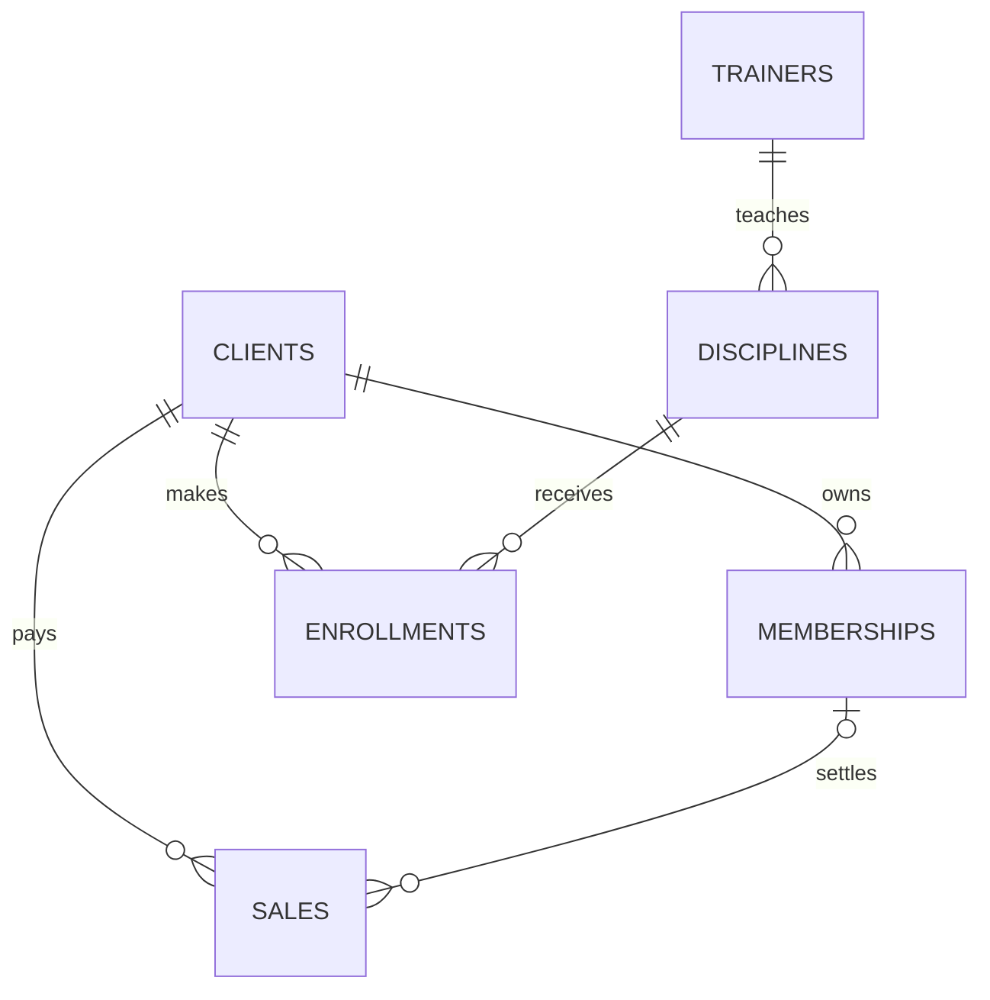

# Sistema Integral de Gestión para Gimnasios

## Asignatura

Taller de Aplicación en Internet

## Tecnologías

Python, Flask-AppBuilder 5.3, SQLAlchemy, MySQL 8, PyMySQL, scikit-learn y Git/GitHub.

## Resumen

Gym Manager centraliza clientes, entrenadores, disciplinas, membresías, inscripciones y ventas. El sistema ofrece autenticación con usuario y contraseña, permisos de Flask-AppBuilder, formularios CRUD, reglas de negocio, tres reportes filtrables y un recomendador local de disciplinas basado en inteligencia artificial.

## Objetivo general

Desarrollar una aplicación web segura para administrar la operación básica de un gimnasio y convertir sus registros en información para la toma de decisiones.

## Modelo relacional



Las seis tablas propias son `clients`, `trainers`, `disciplines`, `memberships`, `enrollments` y `sales`. Las claves foráneas evitan registros aislados y permiten consultar el negocio desde diferentes perspectivas.

## Reglas de negocio

- El correo del cliente se guarda normalizado en minúsculas y es único.
- Una disciplina debe tener capacidad positiva y una tarifa no negativa.
- La fecha final de una membresía no puede ser anterior a la fecha inicial.
- Una venta debe tener un monto mayor que cero.
- Un cliente no puede inscribirse dos veces en la misma disciplina.
- Una disciplina no permite más inscripciones activas que su capacidad.

## Inteligencia artificial

El módulo `app/ai.py` utiliza `TfidfVectorizer` y `cosine_similarity` de scikit-learn. El texto del objetivo del cliente se compara con el nombre, categoría, horario y descripción de cada disciplina. El resultado ordena las tres disciplinas disponibles con mayor similitud y se muestra en la vista web y en la ruta JSON.

La implementación es local, gratuita y reproducible. No requiere una clave de API ni envía información del gimnasio a un proveedor externo.

## Reportes

1. **Ventas por período**. Filtra por fechas y método de pago, lista las operaciones y calcula el total.
2. **Membresías**. Agrupa por plan y estado, cuenta clientes y suma el ingreso mensual estimado.
3. **Ocupación**. Compara inscripciones activas con la capacidad de cada disciplina y calcula el porcentaje.

## Autenticación y permisos

Flask-AppBuilder crea el inicio de sesión, las vistas de seguridad y los permisos por vista. Las vistas CRUD usan permisos de lista, creación, consulta, edición y eliminación. El recomendador y los reportes usan `@has_access`. La API de IA usa `@login_required`.

## Ejecución

```bash
python -m venv .venv
source .venv/bin/activate       # Windows: .venv\\Scripts\\activate
pip install -r requirements.txt
cp .env.example .env
python scripts/init_db.py
python scripts/seed_data.py
python scripts/create_admin.py
python run.py
```

Para usar MySQL se puede iniciar el servicio definido en `docker-compose.yml` y conservar el `DATABASE_URL` de `.env.example`.

## Pruebas realizadas

```bash
python -m pytest -q
```

El proyecto incluye pruebas de relaciones entre las seis entidades, recomendación IA y protección de rutas. La ejecución final verificada fue `2 passed`.

## Evidencia de Git

El repositorio contiene tres ramas de funcionalidad fusionadas en `main`.

- `feature/modelos` contiene las entidades, relaciones, CRUD y scripts de carga.
- `feature/ia-recomendador` contiene el modelo local y la vista de recomendaciones.
- `feature/reportes` contiene los tres reportes y esta documentación.

Comandos de evidencia:

```bash
git branch -a
git log --oneline --decorate --graph --all
git status
git remote -v
```

## Matriz de evaluación

| Criterio | Evidencia en el proyecto |
|---|---|
| Seis tablas relacionadas | `app/models.py` y `docs/SQL_SCHEMA.sql` |
| CRUD, relaciones, autenticación y permisos | `app/views.py`, menú Gestión y seguridad FAB |
| IA gratuita | `app/ai.py`, menú Recomendador IA y endpoint JSON |
| Tres reportes | `app/reports.py` y plantillas en `app/templates/reports/` |
| Git, ramas, commits y merge | `git log --graph --all` y ramas `feature/*` |
| Evidencias, documentación y pruebas | `docs/DEFENSA.md`, este informe y `tests/` |
